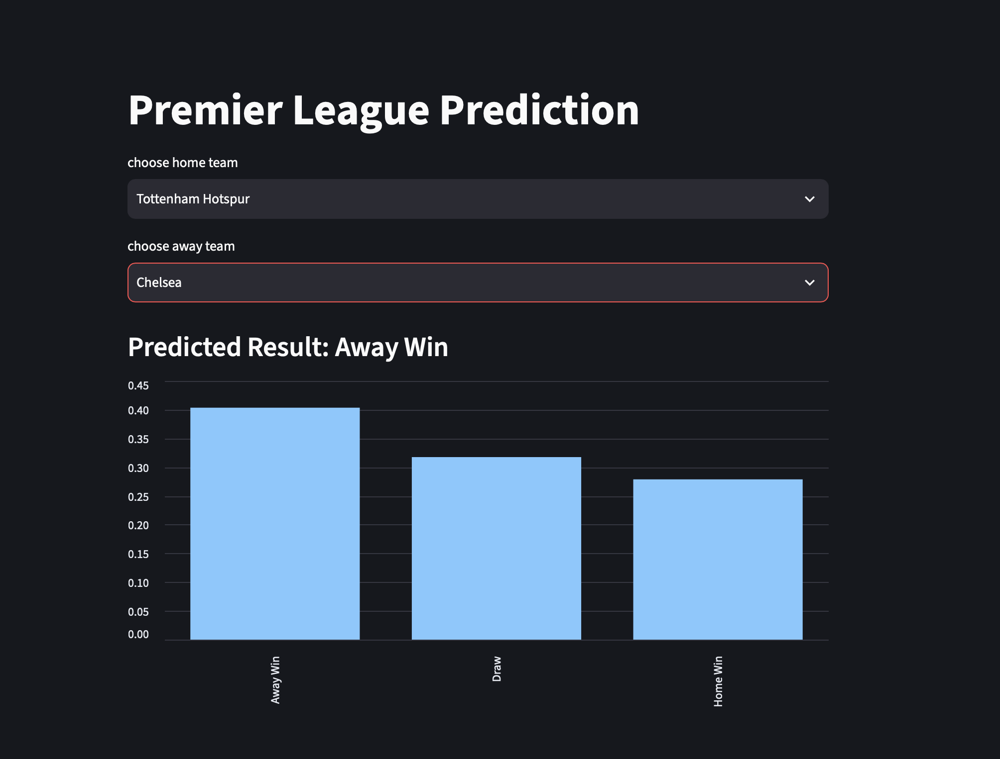

# ⚽ Premier League Match Predictor

> Predicting Premier League 2024/25 match outcomes (Home Win / Draw / Away Win) with machine learning, using features built from raw match results and a live Streamlit app.

[](https://premier-league-analytics-2024-25.streamlit.app)

**Live demo:** https://premier-league-analytics-2024-25.streamlit.app



Select a home team and an away team to get a predicted result with probability scores.

---

## What the app does

- The user picks a **home team** and an **away team**.
- The app looks up each team's most recent feature values (built from matches played before that point).
- A tuned XGBoost model predicts **Home Win / Draw / Away Win**.
- The probabilities are shown as a bar chart.

---

## Features engineered

All features are built chronologically from raw match results. For each match, every feature uses **only matches played before it**, so the model never sees the result it is predicting. The code is in `main.py`.

| Feature | Description |
|---|---|
| `home_team_total_wins` / `away_team_total_wins` | Wins so far this season, before the match |
| `home_team_win_at_home` | Home team's wins at home so far |
| `home_team_win_away` | Home team's wins away so far |
| `away_team_win_at_home` | Away team's wins at home so far |
| `away_team_win_away` | Away team's wins away so far |
| `home_team_last5_goals_scored` / `away_team_last5_goals_scored` | Average goals scored over the team's last 5 matches |
| `home_team_last5_goals_conceded` / `away_team_last5_goals_conceded` | Average goals conceded over the team's last 5 matches |

---

## Results (held-out test set)

- Data: 380 matches (2024/25 season). **Random 80/20 split, stratified, `random_state=42`: 76 test matches.**
- Model: XGBoost tuned with `GridSearchCV` (scoring: macro F1, balanced sample weights).

| Metric | Value |
|---|---|
| Accuracy | **48.7%** (about ±11 points at 95%, because only 76 matches) |
| Macro F1 | **0.447** |
| Baseline: always predict Home Win | 40.8% accuracy |

Per class (test set):

| Class | Precision | Recall | F1 |
|---|---|---|---|
| Away Win | 0.54 | 0.50 | 0.52 |
| Draw | 0.29 | 0.21 | 0.24 |
| Home Win | 0.53 | 0.65 | 0.58 |

How to read this: the model beats the always-Home baseline by about 8 points, but with 76 test matches that gap is within the margin of error, so this is **a weak signal, not a proven edge**. It struggles most with draws, which is common in football prediction. With one season of data and no player-level features, that is the expected result, and it is why the project reports macro F1 and not only accuracy.

Reproduce these numbers: `python evaluate.py` (uses the saved `model.pkl` and the same split as training).

---

## Which features matter

Feature importance of the tuned XGBoost (`python evaluate.py` prints all ten):

| Feature | Importance |
|---|---|
| `home_team_last5_goals_conceded` | 0.138 |
| `home_team_win_away` | 0.128 |
| `away_team_last5_goals_scored` | 0.107 |
| `away_team_win_at_home` | 0.098 |
| `away_team_total_wins` | 0.097 |

The home team's recent goals conceded ranks first, but only narrowly: the ten importances range from 0.079 to 0.138, so no single feature dominates. For the home team, defensive form (goals conceded, 0.138) ranks above attacking form (goals scored, 0.088), while for the away team it is the other way round (scored 0.107, conceded 0.092). With 380 matches, these rankings are suggestive, not conclusive, and importance does not show cause.

---

## Why macro F1, not only accuracy

A model that never predicts draws can still reach about 41% accuracy here, so accuracy alone hides a failure. Macro F1 averages the three classes equally, so a model that ignores draws is penalised.

---

## Limitations

- One season, 380 matches, 76 in the test set: results are noisy.
- The train/test split is random, not by date. Features use only past matches, but the model is trained on some later matches than it is tested on. A time-based split would be stricter.
- No player-level data (injuries, lineups, expected goals).

---

## Tech stack

Python, Pandas, NumPy, Scikit-learn, XGBoost, Streamlit, Joblib, Git/GitHub.

---

## Run locally

```bash
git clone https://github.com/amiralialzd/premier-league-analytics
cd premier-league-analytics
pip install -r requirements.txt
streamlit run app.py
```

To re-evaluate the saved model: `python evaluate.py`.
To retrain (this overwrites `model.pkl`, and results may differ slightly from the numbers above): `pip install matplotlib` and `python main.py`.

---

## Data

- Source: FBref, collected with the `soccerdata` Python library.
- Season: 2024/25 Premier League, 380 matches.

---

*Built by [Amirali Alizadeh](https://linkedin.com/in/amiralializadeh)*